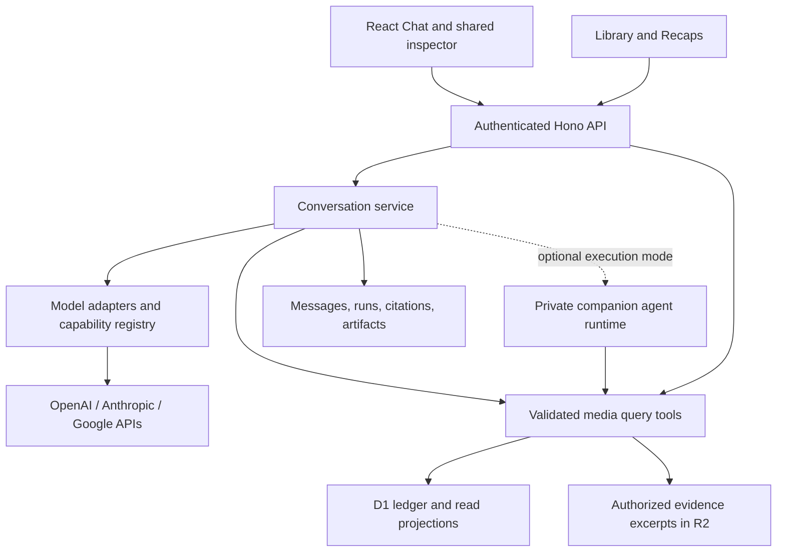

# AI Chat Implementation Proposal

- Status: Proposed; implementation and provider choices remain open
- Researched: 2026-09-19
- Scope: Multi-model Chat over the personal media ledger, with reusable queries
  for Library and Recaps

## Recommendation

Build one application-owned conversation and retrieval layer with interchangeable
model adapters. Support multiple providers and explicit model selection; do not
tie history, citations, artifacts, or media queries to a vendor's conversation
store. Start with read-only questions about imported media and deterministic
analytics. Add semantic retrieval, catalog discovery, and richer artifacts in
separate increments.

Keep React/Vite, Hono, D1, R2, and the canonical ledger. The main prerequisite is
a richer query interface over the evidence already stored. An initial answer to
“Which books did I finish last year?” does not require embeddings, fine-tuning,
or a new database.

Provisional delivery preference: hosted API access first, with a bounded
subscription-access experiment before committing to a companion runtime. The
owner's preference for hosted availability versus a Mac companion remains open.

## Observed starting point

The selected Index study includes Chat history, a composer, clickable Library
references, an inline expandable activity chart, and saved artifacts. The newer
component specimen also includes a local chat composer. Both use synthetic data
and ephemeral state. Preserve the selected shell and the single compact
inspector described in the [UI foundation](../design/ui-foundation.md).

The operational client currently routes to History and Connections.
`MediaSummarySchema` and both media endpoints expose only ID, type, and title
per item. `listMediaPage` supports type filtering, pagination, and complete
counts, but not text search or period filtering. The schema already retains
creators, descriptions, URLs, artwork, date precision, durations, Archive
occurrences, source-scale ratings, reviews, external identities, and evidence
links. Field availability varies by connector.

There are no implemented chat, artifact, text-chunk, embedding, or Queue tables.
Readwise's production client does not request HTML content or run the separate
highlight export. Raw preservation therefore does not imply that every article,
highlight, book text, or transcript is present. The queue consumer is a
placeholder; background indexing would require a real consumer and recovery
behavior.

Code anchors:

- [Production routes](../../apps/web/src/router.tsx)
- [Media contracts](../../packages/contracts/src/index.ts)
- [Repository methods](../../packages/db/src/repository.ts)
- [Ledger schema](../../packages/db/src/schema.ts)
- [Reader acquisition](../../packages/connectors/readwise/src/client.ts)
- [Worker handlers](../../apps/api/src/index.ts)

## Model access and subscription economics

Separate **provider/model** from **access mode**. A provider can offer both a
metered API and a subscription-backed agent runtime, with different quotas,
capabilities, data policies, and deployment requirements.

| Path                                       | Current evidence                                                                                                                                                     | Implication for this app                                                                                               |
| ------------------------------------------ | -------------------------------------------------------------------------------------------------------------------------------------------------------------------- | ---------------------------------------------------------------------------------------------------------------------- |
| Direct OpenAI, Anthropic, or Google API    | Independently authenticated API access; usage billing and any applicable credits                                                                                     | Natural hosted integration through server-side adapters; model credentials stay out of the browser                     |
| Codex with ChatGPT sign-in                 | Official authentication supports subscription access; App Server supports custom clients and managed ChatGPT login                                                   | Candidate companion service using supported Codex authentication, with subscription limits shared with other Codex use |
| Claude Agent SDK with subscription sign-in | Anthropic's June 15 update says SDK, `claude -p`, and third-party app usage still draw from subscription limits; its proposed separate monthly SDK credit was paused | Candidate companion adapter; recheck policy and actual account eligibility before implementation                       |
| Google subscription developer benefits     | Google documents monthly Cloud credits with eligible AI Pro/Ultra developer benefits, including use of Vertex AI                                                     | Investigate redemption and the eligible billing path; do not treat Gemini app access as an unlimited API entitlement   |

Sources: [OpenAI authentication](https://learn.chatgpt.com/docs/auth),
[Codex App Server](https://learn.chatgpt.com/docs/app-server),
[Codex SDK](https://learn.chatgpt.com/docs/codex-sdk),
[Claude subscription SDK update](https://support.claude.com/en/articles/15036540-use-the-claude-agent-sdk-with-your-claude-plan),
[Claude API authentication](https://platform.claude.com/docs/en/manage-claude/authentication),
[Gemini billing](https://ai.google.dev/gemini-api/docs/billing), and
[Google developer benefits](https://developers.google.com/profile/help/faq).

Subscription-backed access is worth exploring for this single-user app, but is
not a general discounted API key. Use supported agent login and runtime
interfaces rather than copying browser session tokens into Worker requests.
Account-specific access and limits have not been tested in this research.

Codex App Server is a local process with an event protocol. Treat agent-runtime
access as a separate deployment mode, not a drop-in HTTP model adapter inside
the existing Worker. A Mac companion would need to be running for those turns.
A separate always-on host is another option, with its own operating cost.

For a companion experiment, retain Hono as the application authority. Pair the
companion privately, use an authenticated outbound job connection, lease each
run, and give it only the scoped media tools it needs. Keep subscription
credentials on the companion. Do not expose a general shell agent or unauthenticated
local WebSocket to the web. Determine whether each runtime can enforce the
required tool restrictions before adopting it.

For cost context, the current OpenAI standard short-context prices list
GPT-5.6 Luna at $0.20 input/$1.20 output and Terra at $2/$12 per million tokens.
At 10,000 total input and 2,000 billed output tokens across a complete turn,
that is approximately $0.0044 or $0.044 respectively; 300 such turns would be
$1.32 or $13.20. This is arithmetic, not a workload forecast or model-quality
recommendation. Repeated context, reasoning output, web search, embeddings, and
long conversations can change costs materially.
[Official pricing](https://developers.openai.com/api/docs/pricing).

Measure the same representative questions across enabled providers before
choosing defaults. Start with a low-cost model and a stronger alternative only
after retrieval, tool-use accuracy, latency, and answer quality justify them.
Record usage and estimated cost per run, cap tool steps/context/output, and
require an explicit configured policy for paid fallback after subscription
limits. Do not silently switch providers or spend money through another route.

## Proposed application shape

Proposed package ownership:

- `packages/ai`: provider adapters, bounded orchestration, tool definitions,
  capability checks, and conversion between provider events and app events.
  Inject repository, clock, and storage interfaces; no Cloudflare bindings.
- `packages/db`: media query methods, search projections, conversation/artifact
  persistence, and ordered migrations.
- `packages/contracts`: validated query inputs, evidence references, message
  parts, artifact specifications, and streaming events.
- `apps/api`: authentication, provider secrets, route wiring, streamed responses,
  and any background indexing bindings.
- `apps/web`: production Chat UI, model selector, history, source cards, shared
  inspector, and artifact rendering using the accepted component foundation.
- Optional `apps/ai-runner`: companion deployment only if the access experiment
  earns its extra operational complexity.

Evaluate Vercel AI SDK Core as an adapter/streaming implementation: its provider
registry is intended for multiple model providers. Keep its types behind our
boundary and verify the pinned version with Hono/Workers before adoption.
Direct vendor SDKs behind the same interface are a valid fallback. A hosted
gateway is optional and does not itself supply subscription entitlement.
[Provider registry documentation](https://ai-sdk.dev/docs/ai-sdk-core/provider-management).

Keep a registry of provider, model ID, access mode, tool/structured-output
support, context limits, enabled status, and cost metadata. Store the actual
model and access route on every run. Allow changing the model for subsequent
turns using an app-owned transcript. Provider reasoning state and native tool
items are not interchangeable: reconstruct portable visible context, and
re-retrieve evidence when necessary. Do not promise transfer of hidden state.

## Query tools and evidence

The [detailed query design](ai-query-design.md) specifies the model/tool round
trip, shared service and HTTP endpoints, structured aggregation, D1 full-text
search, and later semantic retrieval.

Start with four bounded, read-only tools backed by validated parameters and
parameterized repository queries:

| Tool                | Purpose                                                                                                                   |
| ------------------- | ------------------------------------------------------------------------------------------------------------------------- |
| `search_media`      | Title/creator/text search plus type, source, rating, and consumption-period filters; bounded results with pagination      |
| `get_media_details` | Complete supported occurrences, metadata, source-scale ratings/reviews, and source references for specified IDs           |
| `aggregate_history` | Exact counts and supported metrics, grouped by period/type/creator, with explicit unique-item versus occurrence semantics |
| `get_evidence`      | Selected source excerpts or authorized text with immutable record/version references and locators                         |

These are internal application functions first. A later MCP adapter can expose
the same tools to external assistants or companion runtimes without duplicating
query logic. MCP supplies tool access, not inference or billing.

The model chooses tools and explains results. The server computes totals and
validates identities. Do not accept arbitrary model-written SQL. A search page
is not the complete collection, and ranked retrieval cannot establish an exact
total. Aggregate results should carry the query, as-of time, coverage, and a
drill-down reference to their supporting item/occurrence set.

Preserve ledger semantics in every query:

- Date filters match any supported occurrence; an item appears once in Library,
  sorted by its latest matching occurrence. Details retain the complete history.
- Unknown consumption dates remain unknown. Handle day/month/year precision,
  inferred dates, and instant-to-user-timezone boundaries explicitly; partial
  precision overlapping a narrower period must remain uncertain.
- Exclude superseded projections according to reconciliation rules while
  retaining access to historical evidence.
- Distinguish movie watches from unique films and book rereads from distinct
  books. Spotify's canonical episode occurrence is not a count of listening
  sessions: historical listening totals require a playback-segment projection.
- Runtime is not observed time spent. Missing text cannot support quotations.
  Source coverage gaps constrain claims such as “all,” “never,” and “most.”

Every answer's evidence references must resolve to records actually returned
to that run. Store IDs, source versions/hashes, excerpt locators, and relevant
query parameters alongside the answer. Clicking a media reference opens the
shared inspector; an evidence reference can reveal the supporting excerpt or
aggregate. Referential validation prevents fabricated IDs but does not prove
that an answer accurately interprets its evidence; evaluation must test both.

## Text search and semantic retrieval

First expose stored metadata and reviews and add a rebuildable lexical search
projection. D1 documents FTS5 support; validate ranking, migrations, and updates
in the implementation and keep indexing behind repository methods. Add source-owned note/highlight projections
when required, linked to their parent records without turning them into consumed
Archive items.

For deeper questions such as “What have I read about attention?”, add authorized
Reader text/highlight acquisition and a corpus inventory that distinguishes
metadata-only, excerpt, and full-text availability. Then add chunks and optional
embeddings with source-record IDs, content hashes, extractor versions, locators,
embedding model/version, and dimensions. Model access for chat and for embeddings
must be separate configuration choices.

Combine keyword and semantic retrieval with metadata filters and evidence
fetching. Select a vector backend only after measuring corpus size and retrieval
quality; it is not a prerequisite for the first release. Changing embedding
models requires a versioned reindex, not mixing incompatible vectors.

Indexing must be idempotent, replayable, and eventually consistent: enqueue via
a durable outbox or equivalent recoverable post-commit mechanism; reconcile
missed work; invalidate changed or retired source versions. Validate retrieved
IDs against current authoritative state and disclose indexing lag. Ingestion
cursors must never depend on a successful LLM call.

## Conversations, artifacts, and external references

Add app-owned conversations, messages, runs, evidence links, artifacts, and
artifact revisions. Final table decomposition belongs in the implementation
design. At minimum persist:

- Conversation title, ordered messages, timestamps, and selected defaults.
- Run ID, client idempotency key, status, provider/model/access mode, prompt/tool
  versions, usage, failures, and source references.
- Typed message parts: text, media references, citations, and artifact references.
- Named artifact versions with originating conversation/message/run, a validated
  specification, supporting data snapshot, and as-of time.

Stream text and tool status through an app-owned event contract. Support stop,
retry, failed/partial turns, and reload of persisted messages. Persist the run
before inference; prevent a duplicate send from creating two billed runs. A
disconnected first implementation may mark an interrupted run for explicit retry;
do not promise background completion without durable execution support.

For charts, have the model request a supported chart specification and let the
server supply computed data. Render trusted React chart/list components with
click-through filters; share them with Recaps. Saved artifacts are snapshots;
refresh creates a new revision rather than silently changing an old answer.
Arbitrary generated HTML/JavaScript needs a separate sandbox design and is not
necessary for the initial charts or generated lists.

Broader recommendations need catalog/search providers in addition to models.
Represent references explicitly as Library items or external catalog references.
Inspecting a catalog result must not add it to Archive or Queue. Validate external
identities and label ambiguous matches. Follow the existing
[catalog reconnaissance](../sources/catalogs.md) when selecting integrations.
The mock's “Library + web” label is not evidence that discovery exists.

## Privacy and failure boundaries

Before enabling real queries, extend the threat model with provider-specific
data egress and retention settings. Send bounded relevant records rather than
entire raw exports. Preserve source content as untrusted data, never executable
instructions. Keep tools read-only and enforce permissions and size limits in
code. Logs should contain run IDs and usage, not private prompts or excerpts.

Provider changes may send conversation context to a new recipient; make the
selected provider visible and constrain fallback to configured choices. Avoid
free-tier assumptions for private data: Google's billing guide explicitly
distinguishes paid-tier data treatment. Subscription and API modes can also have
different retention policies. Conversation deletion must cover artifacts and
any provider-side state created by the integration.

## Delivery sequence and acceptance

1. **Query foundation.** Expand media summaries/details, occurrence-aware filters,
   exact aggregation, provenance references, and lexical search. Prove them with
   synthetic duplicate, unknown-date, partial-date, timezone, source-gap, and
   reconciled-occurrence cases. Library and Recaps reuse this work.
2. **First complete Chat flow.** Add persistence, streamed turns, cancellation,
   citations, and the Index Chat surface. Implement two provider adapters and
   run the same fixture questions through both. Model switching must preserve
   visible history and source links. Use a fake provider for CI; live evaluation
   is a separately configured measured exercise.
3. **Subscription experiment.** Test one supported companion route, constrained
   media tools, sign-in, quotas, stream translation, offline behavior, and
   cross-model continuation. If subscription access is the owner's priority,
   move this experiment before production model adapter selection.
4. **Saved outputs and Recaps reuse.** Named lists and chart artifacts with
   immutable revisions, source links, and deterministic drill-downs. No generic
   visualization builder is required.
5. **Semantic evidence.** Authorized text/highlight ingestion, corpus coverage,
   chunking, indexing, and retrieval evaluations. Quotes must resolve to actual
   stored text; metadata-only answers must say what supports them.
6. **Discovery.** Catalog references and optional web retrieval with resolved
   identities, separate from imported Library membership.

Use a small evaluation set covering exact history questions, cross-media
comparisons, thematic synthesis, unavailable evidence, malicious imported text,
invalid citations, provider failures, cancellation, and model changes. Measure
retrieval recall, numerical accuracy, evidence support, latency, and total
turn cost. No provider should pass by producing plausible prose alone.

Implementation changes require `pnpm check`, relevant builds and end-to-end
checks, and migrations tested from both empty and previous schema states. This
proposal does not modify runtime code, provision services, or invoke paid models.
An ADR should record the eventual provider/runtime boundary before shipping;
this proposal does not supersede accepted architecture decisions.
