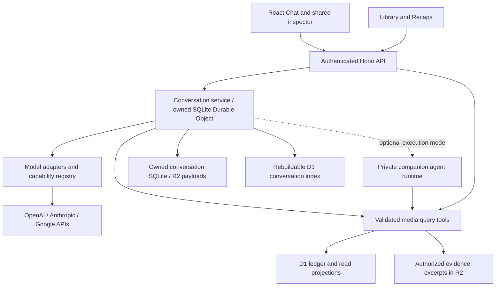

# AI Chat Implementation Proposal

- Status: Familiar Chat implemented; rollout is recorded by exact-revision release receipts
- Researched: 2026-09-19
- Updated: 2026-10-30; Pro subscription linked and available API credits confirmed
- Scope: Multi-model Chat over the personal media ledger, with reusable queries
  for Library and Recaps

## Recommendation

Hard requirements: implement OpenAI first, design for adding/replacing providers,
and fund inference from the owner's personal subscription with no additional API
payment or automatic paid fallback. Prefer ordinary hosted Responses funded by
Pro's included API credits, after funding verification. The
[subscription/access design](chat-subscription-access.md) distinguishes this route
from SIWC shared ChatGPT allowance and records exact access/billing limits.

The [setup options](chat-options.md) compare current SDK, Cloudflare, managed
agent, and larger-framework approaches. Three independent data-only reviews and
the [backend design](chat-implementation-design.md) cover the full lifecycle;
The implementation uses owned SQLite Durable Objects and provider/tool adapters
under [ADR 0023](../decisions/0023-owned-chat-runtime.md). The initial assistant includes general chat and web tools alongside
Library access; web access is not deferred until
catalog discovery.

Build one application-owned conversation and retrieval layer with interchangeable
model adapters. Support multiple providers through the owned configuration and capability boundary; do not
tie history, citations, artifacts, or media queries to a vendor's conversation
store. Start with read-only questions about imported media and deterministic
analytics. Add semantic retrieval, catalog discovery, and richer artifacts in
separate increments.

Keep React/Vite, Hono, D1, R2, and the canonical ledger. Reuse the existing
media-specific repositories, search indexes, and article-content pipeline behind
two tools: `query_media` and `get_media_details`. The main prerequisite is a
shared query and evidence contract with explicit occurrence semantics. An initial
answer to
“Which books did I finish last year?” does not require embeddings, fine-tuning,
or a new database.

The owner has Pro. Included API credits can fund normal hosted API calls without
a separate API payment method; they do not use shared ChatGPT quota. Verify the
receiving organization funding and grant expiry before live inference. The owner
linked the benefit on October 30 and supplied a $43.00 available-credit screenshot.
This route needs neither an always-on Mac nor private-hosted SIWC approval. Local SIWC remains an
explicit alternative, not a fallback. No purchased-credit or paid route is enabled.

## Current implementation

Familiar is selected. The owned API, SQLite history/run/event store, D1 index and
allowance reservations, R2 evidence/checkpoints, OpenAI adapter, two Library tools,
isolated public web search and production UI are implemented. Saved conversations
support rename, Favorites, delete, Stop and SSE reconnect. Export has a versioned
NDJSON contract and a fresh-SQLite recovery port. Runtime/browser checks and the
private guarded release are tracked in the implementation design. The starting
point below records the pre-implementation audit rather than current feature status.

## Observed starting point

The owner accepted a ChatGPT-inspired first release on October 30: New Chat;
unlimited collapsible Favorites and Chats with favorites shown only in Favorites;
hover/focus star/menu actions for rename, favorite and delete; automatic editable
titles; a classic text composer whose Send becomes Stop; and expandable actual
reasoning-summary/tool activity. No message-action toolbar, attachment controls
or model picker initially. The owner selected Familiar. The
[UI/backend contract](chat-ui-contract.md) specifies the state/API implications.

The historical selected Index study includes Chat history, a composer, clickable
Library references, an inline expandable activity chart, and saved artifacts. The newer
component specimen also includes a local chat composer. Both use synthetic data
and ephemeral state. Preserve the selected shell and the single compact
inspector described in the [UI foundation](../design/ui-foundation.md).

Repository review on 2026-10-29 covered merged main through `3044d2a`. The
operational client has all six Library families and Connections; Chat and Recaps
remain disabled. Media-specific contracts/repositories provide collection,
summary, detail, history, and search operations. The generic `/api/media`
endpoints still expose only ID, type, and title. They are not the prerequisite
integration boundary for Chat.

Library collection requests use `section` and return `data`/`nextCursor`;
separate `/summary` requests return media-specific counts, facets, coverage,
capabilities, or freshness. Summaries exclude pagination, sorting, and
presentation parameters. See [Library fetching](../architecture/library-fetching.md).

Browse semantics vary: Books filters by latest read date and sums supported read
counts for matching books; Podcasts filters Archive by latest activity; Movies
distinguishes current and viewing ratings and counts matching watch occurrences;
Music aggregates playback observations within the requested period. Chat must
define occurrence-aware filters and measures rather than treating every browse
filter or summary as an exact historical query.

Source-derived Queue, highlights, article content manifests/chunks, lexical
indexes, private R2 text bodies, and background consumers are implemented.
Article acquisition records source versions, hashes, extraction versions, and
full/partial coverage. Reuse this pipeline for citation-ready retrieval; do not
build a second text store. Availability still varies by item and source.
Chat conversations/runs, saved artifacts, provider adapters, and embeddings remain
unimplemented.

Public ledger/evidence IDs remain stable after evidence-storage compaction;
internal integer storage keys must not become citation identities. Resumable
syncs, partial success, catalog publication fencing/expiry, and index revisions
also require query coverage/freshness and changed-revision handling. Existing
hosted operating gates apply to Chat routes; model-provider costs need their own
limits. A companion needs scoped authentication separate from the restricted
release-smoke identity.

Code anchors:

- [Production routes](../../apps/web/src/router.tsx)
- [Media contracts](../../packages/contracts/src/index.ts)
- [Library HTTP routes](../../apps/api/src/app.ts)
- [Library fetching contract](../architecture/library-fetching.md)
- [Repository methods](../../packages/db/src/repository.ts)
- [Ledger schema](../../packages/db/src/schema.ts)
- [Reader acquisition](../../packages/connectors/readwise/src/client.ts)
- [Worker handlers](../../apps/api/src/index.ts)

## Model access and subscription economics

The [access design](chat-subscription-access.md) owns current verified details.
Earlier September API/subscription assumptions are superseded. An API key is an
authentication mechanism; whether requests incur additional payment depends on
funding. Eligible Pro subscriptions now include finite API credits usable for
Responses and native web tools without adding an API payment method.
[Official benefit](https://developers.openai.com/api/docs/guides/chatgpt-api-credits).

| Access mode                | Initial choice                                                                                                                                                                                        |
| -------------------------- | ----------------------------------------------------------------------------------------------------------------------------------------------------------------------------------------------------- |
| Pro-included API credits   | Recommended: existing private hosted app, direct OpenAI Responses, no purchased funding/Auto Recharge or automatic fallback. Linking/credits confirmed; verify organization funding and grant expiry. |
| SIWC shared plan allowance | Optional: narrower request/tools contract; local personal path documented, private hosted clients selected/approved. Does not become eligible merely because we use a framework or local proxy.       |
| Codex App Server           | Defer: richer local runtime with extra process/history/permission boundaries; no hosted-auth workaround.                                                                                              |
| Other personal providers   | Future adapters require their own supported auth, execution and funding verification. Consumer login never implies generic API access.                                                                |

The owner linked the subscription benefit on October 30 and supplied evidence
of $43.00 available API credit. No provider key or live inference was created by
the agent. Actual model entitlement still requires a bounded smoke test after
funding/key verification; a model catalog alone is insufficient.

Use a receiving API organization with only included credits and no purchased
balance, payment/postpaid funding or Auto Recharge. Credits expire on the
subscription cycle. At exhaustion, stop and retain history; never buy credits or
switch keys/providers. Hard organization/project spend limits are secondary
controls and can lag. Account for every auxiliary model/tool call as well as the
main turn. Cloudflare usage has separate operating budgets and measurement.
[Spend controls](https://developers.openai.com/api/docs/guides/spend-limits).

Keep provider, model, access mode and execution location distinct. A future
personal-runtime adapter may need local processes and different tool/cancellation
protocols. Preserve portable visible history/evidence plus opaque provider state,
with explicit capability negotiation; never assume all vendors implement Responses.

## Proposed application shape

Proposed package ownership:

- `packages/ai`: provider adapters, bounded orchestration, tool definitions,
  capability checks, and conversion between provider events and app events.
  Inject repository, clock, and storage interfaces; no Cloudflare bindings.
- `packages/db`: media query methods, search projections, conversation/artifact
  persistence, and ordered migrations.
- `packages/contracts`: validated query inputs, evidence references, message
  parts, artifact specifications, and streaming events.
- `apps/api`: authentication, provider secrets, route wiring, streamed responses,
  and any background indexing bindings.
- `apps/web`: accepted Chat UI, Favorites/Chats, Send/Stop, typed response activity,
  source references and shared inspector using the accepted component foundation.
  Model picker, attachments, message actions and saved artifacts are future UX.
- Optional `apps/ai-runner`: companion deployment only if an explicitly selected access mode
  earns its extra operational complexity.

Use the official provider SDK behind a neutral adapter; keep provider-native inputs and events out of product/storage contracts.
Released OpenAI request serialization/citation/abort behavior has an offline
probe; complete Hono/Workers lifecycle integration still needs proof. Direct
vendor SDKs behind the same interface are an engineering alternative. Omit
gateway inference/billing from the initial route; it supplies no subscription
entitlement and introduces another funding path.
[Provider registry documentation](https://ai-sdk.dev/docs/ai-sdk-core/provider-management).

Keep a registry of provider, model ID, access mode, tool/structured-output
support, context limits, enabled status, and cost metadata. Store the actual
model and access route on every run. Allow changing the model for subsequent
turns using an app-owned transcript. Provider reasoning state and native tool
items are not interchangeable: reconstruct portable visible context, and
re-retrieve evidence when necessary. Do not promise transfer of hidden state.

## Query tools and evidence

The [detailed query design](ai-query-design.md) specifies the model/tool round
trip, shared service and HTTP endpoints, structured aggregation, D1 full-text
search, and later semantic retrieval.

Use two bounded, read-only tools backed by validated parameters and
parameterized repository queries:

| Tool                | Purpose                                                                                                                                                                                                 |
| ------------------- | ------------------------------------------------------------------------------------------------------------------------------------------------------------------------------------------------------- |
| `query_media`       | Apply shared search/structured filters and return matching items, computed statistics, or both. Items are paginated; statistics cover all matches with explicit measures, units, and optional grouping. |
| `get_media_details` | Retrieve metadata for typed item references, optionally including supported history, reviews, highlights, and relevant authorized text passages, with bounded results and continuation.                 |

Searching and aggregation are capabilities of `query_media`, not separate model
tools. The model selects validated filters, `output: items | statistics | both`,
and supported measures/groupings; the server computes statistics over the full
matching set before pagination. Evidence references accompany relevant facts and
statistics from either tool. `get_media_details` includes optional supporting
content with immutable version references and locators; no separate evidence
tool is required for the initial release.

These are internal application functions first. A later MCP adapter can expose
the same tools to external assistants or companion runtimes without duplicating
query logic. MCP supplies tool access, not inference or billing.

The model chooses tools and explains results. The server computes totals and
validates identities. Do not accept arbitrary model-written SQL. A search page
is not the complete collection, and ranked retrieval cannot establish an exact
total. Aggregate results should carry the query, as-of time, coverage, and a
drill-down reference to their supporting item/occurrence set.

Preserve ledger semantics in every query:

- Chat consumption-date filters match any supported occurrence, and query items
  appear once, sorted by their latest matching occurrence when requested.
  Details retain access to complete history through pagination. This is a Chat
  query requirement, not a claim about every existing Library browse filter.
- Unknown consumption dates remain unknown. Handle day/month/year precision,
  inferred dates, and instant-to-user-timezone boundaries explicitly; partial
  precision overlapping a narrower period must remain uncertain.
- Exclude superseded projections according to reconciliation rules while
  retaining access to historical evidence.
- Distinguish movie watches from unique films and book rereads from distinct
  books. Spotify's canonical episode occurrence is not a count of listening
  sessions: historical listening totals require a playback-segment projection.
- Runtime is not observed time spent. Missing text cannot support quotations.
  Source coverage gaps constrain claims such as “all,” “never,” and “most.”

Every answer's evidence references must resolve to records actually returned
to that run. Store IDs, source versions/hashes, excerpt locators, and relevant
query parameters alongside the answer. Clicking a media reference opens the
shared inspector; an evidence reference can reveal the supporting excerpt or
aggregate. Referential validation prevents fabricated IDs but does not prove
that an answer accurately interprets its evidence; evaluation must test both.

## Text search and semantic retrieval

Reuse existing media-specific FTS5 indexes, metadata, reviews, and article
note/highlight projections. Fill measured field/ranking gaps behind repository
methods, preserving origin references. Notes/highlights remain supporting
evidence, not additional consumed Archive items.

For deeper questions such as “What have I read about attention?”, add authorized
text/highlight retrieval and a corpus inventory that distinguishes metadata-only,
excerpt, and full-text availability. Reuse existing article manifests/chunks and
extend acquisition to other authorized sources as needed. Add optional
embeddings with source-record IDs, content hashes, extractor versions, locators,
embedding model/version, and dimensions. Model access for chat and for embeddings
must be separate configuration choices.

Combine keyword and semantic retrieval with metadata filters and evidence
fetching. Select a vector backend only after measuring corpus size and retrieval
quality; it is not a prerequisite for the first release. Changing embedding
models requires a versioned reindex, not mixing incompatible vectors.

Indexing must be idempotent, replayable, and eventually consistent: enqueue via
a durable outbox or equivalent recoverable post-commit mechanism; reconcile
missed work; invalidate changed or retired source versions. Validate retrieved
IDs against current authoritative state and disclose indexing lag. Ingestion
cursors must never depend on a successful LLM call.

## Conversations, artifacts, and external references

Add app-owned conversations, messages, runs, evidence links, artifacts, and
artifact revisions. Final table decomposition belongs in the implementation
design. At minimum persist:

- Conversation title/origin and metadata revision, favorite, activity timestamp,
  ordered messages/transcript revision, deletion state and selected defaults.
- Run ID, client idempotency key, status, provider/model/access mode, prompt/tool
  versions, usage, failures, and source references.
- Typed first-release parts: text, provider-approved reasoning summaries, tool
  activity, media references and citations. Opaque provider state stays server-side;
  artifact parts remain future scope.
- Named artifact versions with originating conversation/message/run, a validated
  specification, supporting data snapshot, and as-of time.

Stream text, distinct reasoning summaries and actual tool lifecycles through an
app-owned event contract. Persist them for replay and stable call counts; summaries
are optional model capabilities and cannot be replaced by invented thinking text.
See the [UI/backend contract](chat-ui-contract.md) for display/event mappings. Support stop,
retry, failed/partial turns, and reload of persisted messages. Persist the run
before inference; prevent a duplicate send from creating two billed runs. A
disconnected first implementation may mark an interrupted run for explicit retry;
do not promise background completion without durable execution support.

For charts, have the model request a supported chart specification and let the
server supply computed data. Render trusted React chart/list components with
click-through filters; share them with Recaps. Saved artifacts are snapshots;
refresh creates a new revision rather than silently changing an old answer.
Arbitrary generated HTML/JavaScript needs a separate sandbox design and is not
necessary for the initial charts or generated lists.

Broader recommendations need catalog/search providers in addition to models.
Represent references explicitly as Library items or external catalog references.
Inspecting a catalog result must not add it to Archive or Queue. Validate external
identities and label ambiguous matches. Follow the existing
[catalog reconnaissance](../sources/catalogs.md) when selecting integrations.
The mock's “Library + web” label is not evidence that discovery exists.

## Privacy and failure boundaries

Before enabling real queries, extend the threat model with provider-specific
data egress and retention settings. Send bounded relevant records rather than
entire raw exports. Preserve source content as untrusted data, never executable
instructions. Keep tools read-only and enforce permissions and size limits in
code. Logs should contain run IDs and usage, not private prompts or excerpts.

Provider changes may send conversation context to a new recipient; make the
selected provider visible and constrain fallback to configured choices. Avoid
free-tier assumptions for private data: Google's billing guide explicitly
distinguishes paid-tier data treatment. Subscription and API modes can also have
different retention policies. Conversation deletion must cover artifacts and
any provider-side state created by the integration.

## Delivery sequence and acceptance

The [backend milestones](chat-implementation-design.md#implementation-milestones-independent-of-final-ui)
own the current UI-independent sequencing: contracts, durable execution proof,
history/replay/cancellation, accepted sidebar/activity contracts, first provider
plus Library/web tools, initial UI release, then files and richer capabilities. The longer-term feature sequence below remains useful but
does not postpone ordinary web research behind saved artifacts or embeddings.

1. **Query foundation.** Reuse media repositories, lexical indexes, and article
   content. Define `query_media` with items/statistics/both output and
   `get_media_details` with optional supporting evidence. Add occurrence-aware
   filters, exact measures/groupings, and citation/version references. Prove them
   with
   synthetic duplicate, unknown-date, partial-date, timezone, source-gap, and
   reconciled-occurrence cases. Library and Recaps reuse this work.
2. **First complete Chat flow.** Add persistence, streamed turns, cancellation,
   citations, and the Index Chat surface. Implement OpenAI subscription access and
   a fake adapter with a different capability profile; future live providers use
   the same contracts. The selected first UI has no model picker or message
   toolbar; future model switching must preserve visible history and source links. Use a fake provider for CI; live evaluation
   is a separately configured measured exercise.
3. **Subscription acceptance.** Pro benefit/funding verification precedes live
   inference; released-package lifecycle proof precedes implementation adoption.
   Verify actual grant/expiry, ordinary Responses and web/Library access,
   interruption, injected quota errors and offline behavior. SIWC sign-in/renewal
   checks apply only if that distinct access mode is later selected. No separately
   billed fallback.
4. **Saved outputs and Recaps reuse.** Named lists and chart artifacts with
   immutable revisions, source links, and deterministic drill-downs. No generic
   visualization builder is required.
5. **Semantic evidence.** Extend authorized content coverage and existing
   chunking/indexing where needed; evaluate hybrid retrieval. Quotes must resolve
   to actual
   stored text; metadata-only answers must say what supports them.
6. **Discovery.** Catalog references and broader discovery with resolved
   identities, separate from imported Library membership.

Use a small evaluation set covering exact history questions, cross-media
comparisons, thematic synthesis, unavailable evidence, malicious imported text,
invalid citations, provider failures, cancellation, and model changes. Measure
retrieval recall, numerical accuracy, evidence support, latency, and total
turn cost. No provider should pass by producing plausible prose alone.

Implementation changes require `pnpm check`, relevant builds and end-to-end
checks, and migrations tested from both empty and previous schema states. This
proposal does not modify runtime code, provision services, or invoke paid models.
An ADR should record the eventual provider/runtime boundary before shipping;
this proposal does not supersede accepted architecture decisions.
