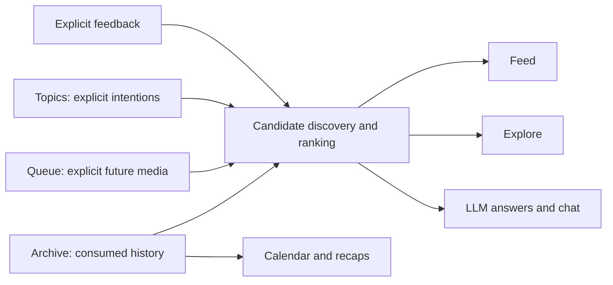

# Long-Term Product Vision

- Status: Initial surface scope agreed; longer-term concepts exploratory
- Last updated: 2026-10-12

## Purpose

Imladris begins as a trustworthy, private record of personal media
consumption. Over time, that record may support reflection, intentional learning,
discovery, and explainable recommendations.

The next product interface is scoped to Chat, Library (Archive + Queue), and
Recaps. Index with a collapsible sidebar is the selected shell. See the
[desktop UI foundation](../design/ui-foundation.md) for the agreed details.
The longer-term discovery and recommendation ideas below remain exploratory;
they are not commitments to build every described feature.

## Durable product primitives

### Archive

Archive is the canonical history of consumed media. It is backed by media items,
external identities, and Archive entries with source provenance. Imported
facts remain authoritative and replayable.

Calendar views, recaps, recommendations, feeds, and LLM answers are projections
over this ledger. They must not become isolated stores of conflicting history.

### Queue

Queue represents explicit intent to consume something in the future. The current
Library reads source-derived membership from Hardcover, Letterboxd, Reader,
Spotify, and YouTube. Manual local Queue intent and write-back remain future
work; local intent may become authoritative under a separate conflict model.
Upstream watchlists and save-for-later services may then be mirrored when
dependable integrations exist.

### Lists and artifacts

Lists may eventually provide arbitrary, deliberately managed collections.
Chat initially needs a way to save and revisit generated outputs such as named
interactive visualizations and lists. Separate artifacts linked to their source
conversation are preferred; bookmarking/renaming a chat is an acceptable MVP
fallback. A future relationship between Artifacts and Lists remains open.

### Topics / Explorations

Explorations is the current tentative surface name for broad learning topics.
It may be integrated into Chat rather than separate navigation. The underlying
Topics concept remains exploratory. Topics are explicit intellectual intentions that do not need to originate from a
saved media item. Examples include:

- "How does IMAX 70mm work?"
- "How do behavior trees work?"
- "Miyazaki animation behind the scenes"

A topic is not media and should never be inserted into Archive as if it were
consumed content. It is a separate first-class signal that can guide discovery,
feeds, recommendations, and chat.

A future topic model may contain:

- Original user-authored text
- Active, paused, completed, or archived state
- Priority or strength
- Creation date and optional expiration
- Desired depth, pace, or time budget
- Preferred or excluded formats
- Derived concepts, entities, and search queries
- Links to discovered, queued, and consumed media

Topics should remain controllable. A user might request one good explanation, a
multi-week learning path, adjacent exploration, or ongoing updates.

## Generated experiences

### Calendar and recaps

Monthly and yearly cross-media rollups are required in the next interface.
They may share a visualization system rather than be separate products.
Broader analytics can grow within the same Recaps workspace.

A calendar provides another lens over Archive entries rather than another
history system. Recaps may summarize a week, month, year, topic, or period in a
more editorial form, similar in spirit to Spotify Wrapped.

Useful recap material may include:

- Volume and time by media type
- Creators, subjects, and sources revisited
- Ratings and consumption patterns
- Meaningful notes or highlights
- Emerging interests and topic clusters
- Comparisons with prior periods

Recaps should favor useful reflection over gamification.

### Feed

A future Feed may surface ambient recommendations and other content related to
past consumption. It may combine saved topics, recent history, queue state, source updates, and
other future signals. An LLM can help expand topics, assess candidates, diversify
formats and perspectives, and compose a coherent sequence. It is an editor over
retrieved candidates, not the source of truth or the sole discovery mechanism.

A feed should support explicit modes such as:

- Teach from first principles
- Stay current
- Explore adjacent ideas
- Fit a time budget
- Prefer a format or level of depth
- Provide one excellent next item rather than an endless stream

### Explore

Explore may recommend content similar to a selected item, creator, topic, or
period of history. It can also surface useful contrasts and adjacent material
rather than only nearest-neighbor similarity.

Archive helps Explore avoid consumed duplicates and estimate appropriate depth.
Queue indicates existing intent. Topics provide explicit direction that history
alone cannot infer.

### LLM search and chat

Natural-language search should answer arbitrary questions over the owner's saved
history, metadata, Archive entries, notes, highlights, and authorized text. Answers must
cite stored evidence and distinguish facts from inference.

Chat is now a primary destination in the agreed initial interface, with new
conversations, history, and saved artifacts. Interactive visualizations can
appear inline and expand. Clickable references should open the shared compact
inspector, including catalog items outside the Library. Inspecting an external
item does not itself add it to Library. The exact balance of personal-history
questions and broader exploration remains to be designed.

## Recommendation flow

For a topic such as "How does IMAX 70mm work?":

1. Preserve the original topic exactly as written.
2. Derive candidate search concepts and queries without replacing the original.
3. Gather candidates from authorized sources, public search, and known media
   catalogs.
4. Use Archive to remove duplicates, connect prior interests, and estimate depth.
5. Use Queue to avoid redundant suggestions and recognize existing intent.
6. Rank and diversify candidates by relevance, quality, novelty, format, and time
   fit.
7. Explain whether each recommendation came from the explicit topic, prior
   history, or both.
8. Record user feedback and resulting queue or consumption actions.

## Generated-data boundaries

Generated outputs should have their own provenance and versioning. They must not
overwrite imported facts.

Future generated records may include:

- Feed runs with input signals and ranking version
- Recommendation candidates and scores
- Inclusion and exclusion reasons
- Recap snapshots
- Topic-derived queries and entities
- Chat messages and cited evidence
- Explicit feedback such as too basic, already known, or different viewpoint

Keeping these records separate makes recommendations auditable, reproducible
where practical, and safe to regenerate as models or ranking logic change.

## Product principles

- User-authored topics outrank inferred interests.
- Generated experiences remain explainable and adjustable.
- Archive, Queue, and Topics are durable inputs; Feed and Explore are projections.
- The product should be useful without an LLM or recommendation service.
- Avoid infinite-feed engagement optimization.
- Preserve uncertainty and incomplete integration coverage.
- Prefer a small number of excellent recommendations over undifferentiated volume.
- Keep speculative features out of the primary interface until they earn a place.

## Delivery boundary

The ledger, provenance, and synchronization remain foundations. The operational
client now implements all six read-only Library families, source-derived Queue,
and imported-item/catalog inspection. Chat, live LLM services, saved artifacts,
manual Queue writes, and recap generation remain deferred. The separate browser
studies cover Chat, Library, and Recaps with illustrative content; their demos
do not implement those services. Further interface work follows the selected Index
foundation and the source-specific design review described in the
[implementation plan](../planning/implementation-plan.md#20-next-interface-design-and-delivery).
Lists, Feed, and Explorations remain future scope.
